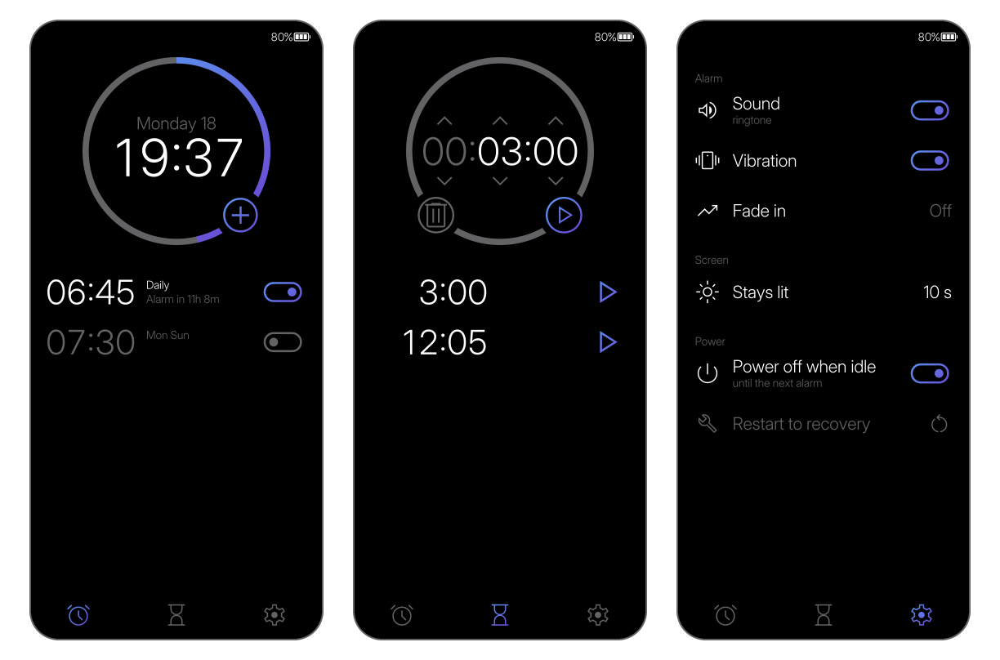

# p20-bedside-clock

[](https://github.com/MichaelWeinhold/p20-bedside-clock/actions/workflows/main.yml)

A bedside clock made from an old Huawei P20 Lite: the Linux kernel the phone already
boots, and one static Rust program as `/init` in place of Android.



## What it does

Up to 12 alarms on chosen weekdays, each ringing with a sound that fades in and the
vibrator until Power ends it. A timer that runs a length without saving it. The panel
lights only when touched; between uses the phone suspends, then can power off until the
RTC switches it on for the next alarm. A charge stops at 80 %, and the LED blinks red on
a low battery, a blink not yet read on the phone.

## How it works

```
kernel = vendor kernel (unchanged)  ──mounts──▶  system as /
                                                   └── /init = alarmd (static, aarch64-musl, Rust)
```

`alarmd` runs as PID 1. It mounts `/dev`, `/sys` and `/proc`, draws to the framebuffer,
`/dev/fb0`, reads `/dev/input/event*`, arms `/dev/rtc0` for the next alarm, and suspends
with `echo mem > /sys/power/state`. The image goes onto `system`, and `alarmd` writes only
its settings record on `reserved4`. `kernel` stays stock, so recovery and fastboot stay
intact and the `system` backup restores the phone.

The logic is kept apart from the hardware: `alarm-core` knows nothing about devices and
takes each one as a trait, so the scheduling rules and the screens are tested on a
laptop and in CI, and only the thin adapters need the phone. →
[docs/ARCHITECTURE.md](docs/ARCHITECTURE.md).

## Running it on your own P20 Lite

The image brings no kernel of its own: it boots whatever is in the phone's `kernel`
partition, and that has to be the kernel below. This is what the phone the project was
built on runs.

| | |
|---|---|
| Phone | Huawei P20 Lite, codename `anne`, model `ANE-LX1` (`devmodel` `ANE-L01`), firmware base `9.1.0.401(C432E13R1P7)` |
| SoC | HiSilicon Kirin 659, 8× Cortex-A53, `aarch64` |
| Bootloader | `Chipset-chicago9.1.0.6(1GA4)_FASTBOOT`, **unlocked** |
| Kernel | `4.9.319-Abdelhay-KSU-`, with KernelSU, from [Abdelhay-Ali/android_kernel_huawei_hi6250_KernelSU](https://github.com/Abdelhay-Ali/android_kernel_huawei_hi6250_KernelSU) |
| Kernel image | release [`2024-04-01-1230`](https://github.com/Abdelhay-Ali/android_kernel_huawei_hi6250_KernelSU/releases/tag/2024-04-01-1230), `Kernel-4.9.319-KSU-enforcing-01042024-1220.img`, 12969984 bytes, sha256 `a8d27ec65ab9d6596980a9aad00d8f22cd0fe70606221058d684f374b605f686` |
| Kernel source | the release's tag, commit `4a89ea72d610f5e3cd7d23d9d3b0919eba9fa8a2`, GPL-2.0 |
| ROM | unofficial LineageOS for Android 9, `0.23-p-20250919-UNOFFICIAL-anne`, `userdebug` |
| Recovery | TWRP 3.7.0_9-0 in `recovery_ramdisk` |
| Connection | USB, `adb` and `fastboot` on the laptop |

The release image is byte for byte what this phone's `kernel` partition holds, up to the
partition's unused tail. To check yours, with `adb root` in the ROM or from TWRP:

```bash
adb shell 'dd if=/dev/block/by-name/kernel bs=12969984 count=1 2>/dev/null | sha256sum'
# a8d27ec65ab9d6596980a9aad00d8f22cd0fe70606221058d684f374b605f686
```

Where the ROM and TWRP were downloaded from is not recorded; several Android 9 builds
for `anne` were tried before this one stuck. The image uses little of the ROM: it keeps
the ROM's `/init` on `system` as `/init.rom`, and the debug `/init` serves the ROM's
shell. Any Android 9 ROM for `anne` with this kernel in `kernel`, `adb root` and TWRP
should do, but only this one has been tried.

**Untested:** writing the release image to `kernel` on a phone whose kernel differs.
That is a write to `kernel` like any other — back the partition up first and follow
[the flashing skill](.claude/skills/flashing-the-phone/SKILL.md). Unlocking the
bootloader is not covered here.

From there, [docs/manual-steps/phone.md](docs/manual-steps/phone.md) is how the phone was
set up, backed up, and how our `/init` goes onto `system`.

## Development

Requirements: [uv](https://docs.astral.sh/uv/) and [rustup](https://rustup.rs/); the Rust
toolchain and the `aarch64-unknown-linux-musl` target install themselves from
`rust-toolchain.toml`.

```bash
uv sync
uv run ruff check . && uv run ruff format --check . && uv run mypy && uv run pytest
uv run python scripts/check_instructions.py
cargo fmt --check && cargo clippy --all-targets --locked -- -D warnings && cargo test --locked
cargo build --release --locked --target aarch64-unknown-linux-musl
```

Linking a binary for the phone needs a Linux host or a cross linker; CI's `image` job
builds the release natively on an `aarch64` runner.

## License

MIT — see [LICENSE](LICENSE). The vendor kernel that the image boots is GPL-2.0 and is not
part of this repository.
